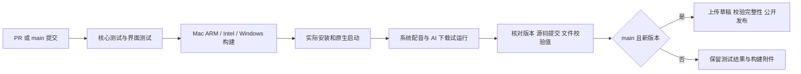

# 桌面版测试与发布

日常修改开 PR，`desktop-pipeline` 自动执行核心测试、完整界面点击测试和三平台安装包检查。PR 的 `release-ready` 成功后可以合并，不需要第二个人批准。PR 不会公开发布安装包。

合入 `main` 后，同一套流程会针对合并后的实际提交再运行一次。当前版本尚未发布时，流水线自动创建发布草稿，上传全部文件，核对远端 SHA-256 和文件大小，最后公开为 GitHub Release。带 `-preview`、`-alpha`、`-beta`、`-rc` 的版本自动标记为预览版。

## 发布一次更新

1. 完成功能或修复。
2. 只用以下命令更新版本号和更新说明，不要分别改安装包文件名、工作流或系统版本字段：

   ```sh
   python3 packaging/bump_version.py 0.3.2-preview --note "简短说明用户会看到的变化"
   ```

   可以重复 `--note` 添加多条。版本号的唯一来源是 `app_paths.py` 的 `VERSION`，说明存放在 `packaging/notes/<版本>.md`。

3. 提交 PR，等待 `release-ready` 成功，再合入 `main`。
4. 在 [Actions](https://github.com/FeeChain/maidcafe/actions/workflows/pipeline.yml) 查看最终结果；安装包自动出现在 [Releases](https://github.com/FeeChain/maidcafe/releases)。首页始终指向这个发布入口，不需要每次手工改链接。

不提升版本号的普通修改仍会测试并提供 Actions 安装包附件，已公开的同版本 Release 保持原样。新版本必须高于已发布版本；请在完成一组改动、准备给用户更新时提升版本号。

## 自动检查什么



Mac 检查 DMG 完整性，挂载后复制其中的应用，再测试这个副本。Windows 实际执行安装程序，测试安装后的 EXE，并验证卸载。三平台检查原生窗口、24 词与录音、系统语音及生成子进程错误回写。Mac ARM / Windows 实际下载并试运行轻量 AI；Intel Mac 验证引擎下载和启动。AI 的语言内容正确性不属于这些自动测试的保证范围。

每个平台生成验证记录。发布阶段只接受三个平台齐全、版本一致、源码提交一致、安装包 SHA-256 与记录一致的文件。发布附件包括三个安装包、对应源码、使用说明、原创词包、验证记录和校验清单。

## 失败与重跑

- 测试或打包失败：打开失败的步骤及 `checks-*`、`ui-log`、`installer-logs-*` 附件定位问题。修复后更新 PR。
- 网络中断或上传失败：同一提交可使用 Actions 的 **Re-run failed jobs** 或 **Re-run all jobs**。未完成的发布保持草稿；同一提交的草稿可以续传并重新校验。
- 已创建草稿后又改了代码：提升版本号再发布，避免将同一版本指向不同源码。旧草稿可以保留排查或手工删除。
- 已公开的版本：重跑不会覆盖旧文件；有修复就发布新版本。需要临时退回时，分享 Releases 里的前一版本，保留出问题版本的来源记录。
- 也可以从 Actions 的 **Run workflow** 选择 `main` 手动重跑，无需上传本机安装包、设置个人访问令牌或逐项批准。

普通构建只有仓库读取权限；只有 `main` 的发布作业获得 GitHub 临时令牌的 `contents: write`。未使用 `pull_request_target`，PR 没有发布步骤。官方 Actions 固定到提交，升级时通过 PR 验证。

## 本地复现

```sh
python3 packaging/run_checks.py
python3 -m pip install -r requirements-dev.txt
python3 -m playwright install chromium
python3 tests/test_ui.py
python3 -m pip install -r requirements-desktop.txt
python3 packaging/build_desktop.py
# 按本机系统选择 macOS-arm64、macOS-x86_64 或 Windows-x64：
python3 packaging/test_installer.py macOS-arm64
```

原生安装检查使用临时目录；AI 测试会联网下载官方引擎与模型。`packaging/publish_release.py` 默认只校验并组装文件，只有显式传入 `--publish` 且位于 `main` 的 GitHub 工作流才会发布。

安装包仍未完成 Apple Developer ID 签名/公证和 Windows 发行签名。以后接入签名时，应在构建后、安装包测试与校验记录生成前签名，避免发布时改变已经验证的文件。
