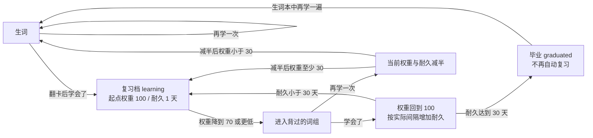

# 单词从生词到复习、再到毕业：0.4.0 代码核对

这份说明以 0.4.0-preview 的实际入口 `/` 为准。复习公式保留旧版实现；界面和分组入口采用我们这次确认的流程。历史文档里的 1/3/7/15/30 固定梯子目前只用于旧数据迁移，不是当前运行规则。

对应发布源码：[dbaf55e](https://github.com/FeeChain/maidcafe/commit/dbaf55ec47e1c0dacd0585e3038300545ee5797e)。

核对时将上一版 main 提交 `a1ef1b1` 与本版源码逐函数比较：`srs_weight`、`srs_due_ts`、`srs_map`、`same_day`、`srs_upsert_learning`、`srs_pass`、`srs_fail` 的语法树全部一致。下文把这些未改的算法和本次改变的使用流程分开列明。

## 两种单位

| 单位 | 当前大小 | 用途 | 代码 |
|---|---:|---|---|
| 难度词段 | 每段 100 词，最后一段可以不足 | 二分／抽样测定、按词段主动考试 | `server.py`：`BLOCK_SIZE`、`attach_tiers` |
| 一组学习 | 默认 20 词，可在设置改为 1–100 | 逐张翻卡、剩余词重学、组末对话 | `static/cafe-ui/domain.js`：`makeQueue`、`createGroup` |

词库先按考试标签排序（中考→高考→四级→六级→考研→托福/雅思→GRE→未标记），同档按 COCA/BNC 中有效的较高频率排序，再切成 100 词段。段内使用单词 MD5 固定打散，因此同一词库重启后顺序稳定。多标签词按最低档归类；词库扩充或导入会重新计算段位，但既有记录仍按单词保存。

本版自带 21,244 个有释义的 ECDICT 词条，并合并使用者自行导入的词包。旧版只带 24 个原创入门词；基础词库扩充后，同一个“第 N 段”的内容可能改变，因此段号不是永久单词标识。五个教学词另有 `tutorial:` 标识，不混入测量或真实学习记录。

## 找到学习起点

用户选择的是**客人当前已经熟练掌握的词汇量**。

| 选择已掌握档位 | 随后学习 |
|---|---|
| CET4 之前 | CET4 及以前的基础词 |
| CET4 | CET6 |
| CET6 | TOEFL 阶段（包含原排序中的考研词） |
| TOEFL | GRE |
| GRE | 未标记的进阶词 |

也可选择二分、抽取或全测。先答听音，再答看词，两项分别保存：1=都不会，2=只看懂，3=两项都可以，4=只听得出。二分边界沿用听音证据：3 个全听出是已知侧；3 个中至少 2 个没听出是生词侧；只有 1 个没听出则再抽 3 个。6 个里至少 5 个听出是已知侧、至多 2 个听出是生词侧，中间情况视作边界段。很短的末段按实际可抽的词数处理。测试队列和当前听／看阶段都会保存。

抽样每个 100 词段抽最多 3 个；全测逐个测试。两者按连续段的听音掌握率至少 85% 确定起点，并把明确没听出的词保留在生词范围。二分保留精确到词段的边界，结果页显示附近的考试档位。源代码：`domain.js` 的 `createAssessment`、`answerAssessment`、`estimateLevel`，`cafe.py` 的 `stage` 和 `commit`。

## 一次学习怎么选词

1. 读取所有在复习档中的词，现算记忆权重。
2. 权重 ≤70、并且今天还没有计入回答的词进入“背过的词”，权重更低的先来。
3. 所有待复习词拆成独立小组。例如 45 个是 20、20、5；这些小组结束后才开始新词。
4. 新词来自明确不熟的词和学习起点之后尚未掌握的词，保留词库难度顺序，独立按默认 20 词分组。
5. 正在进行的词组原样续接；重新打开时，新到期的复习词会放在后续新词组前。

源代码：`cafe.py:snapshot`、`domain.js:makeQueue` 和 `app.js:boot`。旧版 `server.py:build_session` 仍为兼容旧接口保留，旧接口的“20 词内用新词补空位”**不再是当前首页的队列规则**。

## 生词第一次点“学会了”后



首次学会写入 `word_srs` 的 `learning` 状态：`base=100`、`stab=1`、`level=1`、`reviewed_ts=当前时间`。约 24 小时后权重降到 70，便符合首次复习条件。组内“学会了”表示本轮已经会了；长期毕业还要经过之后的复习。没通过的新词只保留生词与当前组进度，不会提前进入复习档。

## 复习公式，直接来自代码

设距离上次计入的回答经过 `t` 天、耐久为 `S`、上次回答后的起点权重为 `B`：

```
当前权重 W = B × 0.7^(t / S)
复习条件：W ≤ 70，并且今天尚未计入回答

复习通过：
  S新 = S × [1 + 3 × (1 − 0.7^(t / S))]
  B新 = 100
  S新 ≥ 30 时毕业

复习未通过：
  B新 = W / 2
  S新 = max(1, S / 2)
  B新 < 30 时回到生词池（lapsed）
```

如果每次恰好在权重降到 70 时通过，耐久依次为 1、1.9、3.61、6.859……天。不会因为隔了一段时间没来就直接判“忘记”或删除记录；回到生词池需要明确的未通过回答。

真实实现位于 `server.py`：`srs_weight`、`srs_due_ts`、`srs_pass`、`srs_fail`。常量仍是 `DECAY=0.7`、`REVIEW_LINE=70`、`GAIN=3`、`LAPSE_FLOOR=30`、`GRAD_STAB=30`，本次没有改公式。

## 同组重学和每日首次结果

- 一轮 20 词有 5 个再学，下一轮就只有 5 个；其中还剩 1 个，下一轮只有 1 个。原来学会的词不补回来。
- 组末对话只从当前轮选词，不足 3／5 个时按实际数量。每次生成保留，听不听均可。所有原始组词都被本轮循环标记学会后才可下一组。
- 普通翻卡现在承担原先“考试通过／未通过”的落库动作。一次点击同时提交 SRS 和当前词卡位置，失败不前进；重复的旧版本请求被拒绝。
- **原有“一天只计第一次结果”仍保留。** 一个复习词今天先点“再学一次”，后来组内重学点“学会了”，可以完成这一组，但今天的复习权重仍按第一次回答计算，不会被当天反复点击刷高。一个全新生词先失败后学会，因为失败时尚无复习档，首次学会可以正常建立复习档。
- 如果今天的首次复习失败使单词回到生词池，当前组仍按约定重学到全部学会；完成后当天不会又把它放进另一组。第二天恢复进入生词队列。这保留了旧版“当天处理过的词不再反复上桌”的规则，也不妨碍本组剩余词循环。
- “生词本→再学一遍”是主动要求重新学习，会拉回生词池；下一次学会从耐久 1 天重新开始。

代码：`domain.js` 的 `judgeGroup`、`retryGroup`、`canAdvance`、`randomTargets`、`chosenTargets`；`cafe.py:commit`；`server.py:same_day`。

## 主动考试、对话和记录

主动考试允许勾选最近真正学过的词（最多 10 个），或完整的 100 词段；入门测量、仅导入未学习的词不会混进“最近学习”。结果仅显示本次掌握／尚需掌握，不调用 `srs_pass` 或 `srs_fail`，不改 `marks`、`word_srs`。考试自身的答题位置可以保存在界面状态里。

生成、播放、重听和跳过对话均不改变复习档。欢迎教学也不改真实掌握记录。AI 生成时的已知背景词来自选定档位／测试边界与明确认识的词，再扣除明确不熟的词；沿用原有覆盖、未知词密度与已知比例检查。单词下方的小对话额外限制为 2–4 句；已有个人已知词证据时，校验发现目标以外的未知词会退稿，重试后仍不满足会报错。内置词形表把 tables / washing 还原为 table / wash，避免误判。语义是否自然、是否准确仍取决于模型，代码没有假装能完全验证词义。

旧学习数据库、设置、词包与录音留在个人数据目录。新界面状态保存在 SQLite `kv` 的 `cafe.state.v1`；数据库备份包含中断词组、背景和当前词卡。主动考试隔离、事务失败、每日首次回答、45 个复习词分组和 20→5→1 重学都有自动化回归。

还有两个容易混淆的“已知”：界面 `mastery.known=true` 包括正在复习与已经毕业的词，用于避免把它们反复当新词。AI 的 `server.py:known_set` 则沿用原设计：边界以内推定已知，加上明确听懂的词，扣除明确不熟的词。新学词在复习档中时仍可作为目标词；只有毕业后才把对应标记改为 3，进入 AI 的已知背景词集合。界面上的本轮“学会了”没有直接把生词变成永久熟词。

## 与之前设计的核对结果

| 项目 | 本版情况 |
|---|---|
| 100 词难度段、考试标签／词频排序 | 保留 |
| 权重衰减、通过增耐久、失败减半、毕业阈值 | 保留 |
| 每天只计首次结果 | 保留，组内通过与长期复习状态需要区分 |
| 新词学会后进入复习档 | 保留，触发入口改为翻卡后的“学会了” |
| 复习与新词混在同一份 20 词内 | 按本次确认，改成所有待复习词先独立分组，然后新词 |
| 重新打开重新抓一份词 | 按本次确认，改成续接当前组与卡片；后续插入新到期复习 |
| 只有考试更新复习状态 | 按本次确认，普通翻卡更新；主动考试只看结果 |
| 校准可跳过、直接让新客给词 | 按本次确认，必须测试或选择已掌握档位，再完成五词教学 |
| 无外部词库只有 24 词 | 扩充到授权基础词库，可能重排段号，单词记录不删除 |
| 固定 1/3/7/15/30 天梯子 | 只保留迁移代码；实际仍是后来确定的连续权重模型 |

## 直接查看实现与验证

| 要核对的问题 | 实现入口 |
|---|---|
| 词段如何排序与切分 | [`attach_tiers`](../server.py#L127) |
| 什么词今天进入复习 | [`snapshot`](../cafe.py#L51) |
| 20 词分组与剩余词循环 | [`makeQueue`](../static/cafe-ui/domain.js#L23)、[`retryGroup`](../static/cafe-ui/domain.js#L19) |
| 权重、首次学会、复习通过、失败 | [`srs_weight`](../server.py#L336)、[`srs_pass`](../server.py#L379)、[`srs_fail`](../server.py#L407) |
| 点击和进度如何一起落库 | [`commit`](../cafe.py#L97) |
| AI 的已知背景词怎么定义 | [`known_set`](../server.py#L530) |
| 主动考试为什么不修改复习档 | [`answerExam`](../static/cafe-ui/domain.js#L43)、[数据库隔离测试](../tests/test_cafe.py) |

[真实数据库测试](../tests/test_cafe.py)覆盖首次学会、失败、同日保护与次日恢复、考试隔离、事务回滚和旧进度保存；[分组测试](../tests/test_domain.mjs)覆盖 45 个复习词、20→5→1 循环及三种测量；[界面旅程](../tests/test_ui.py)实际点击正式页面并检查保存后的状态。
