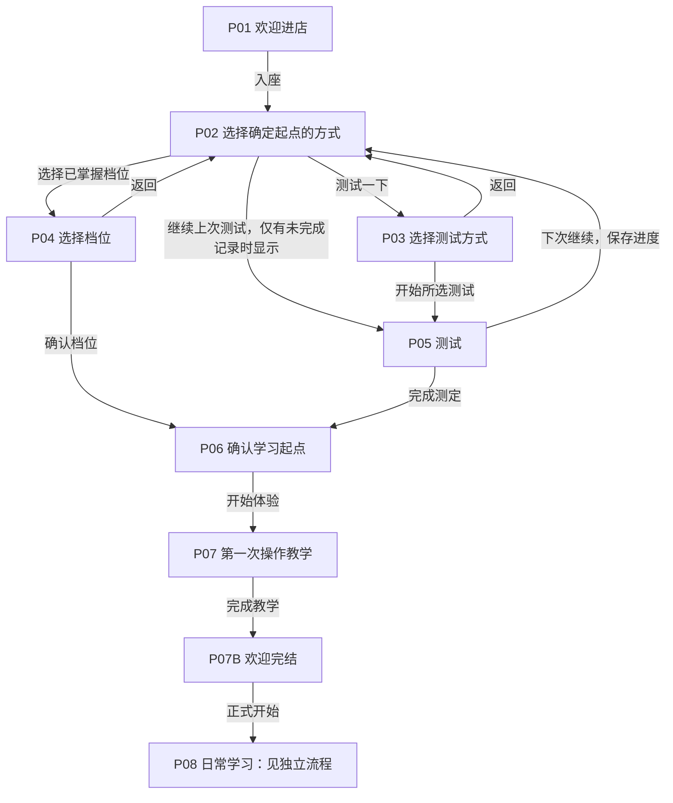
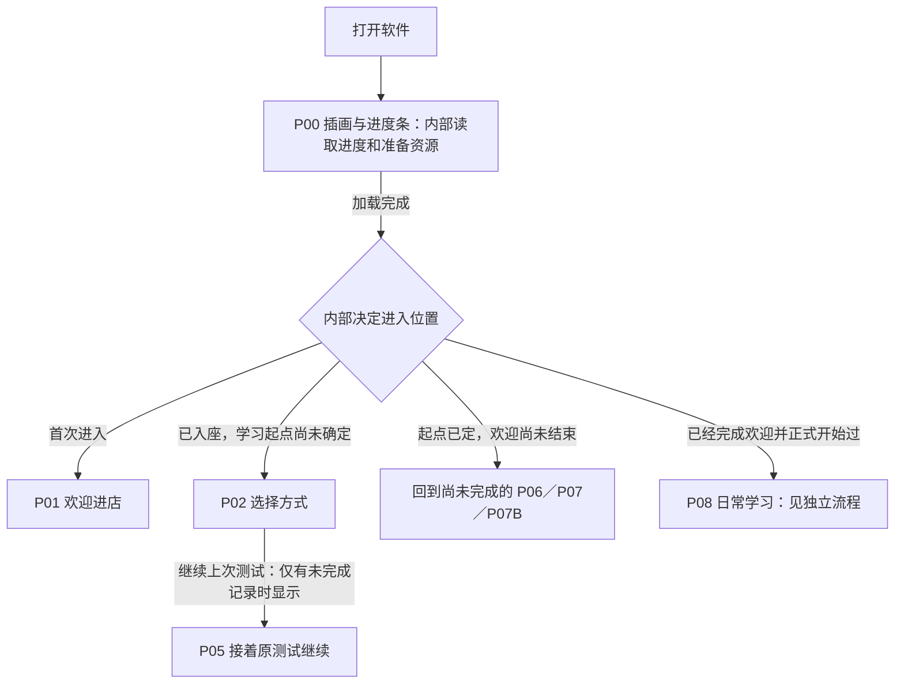
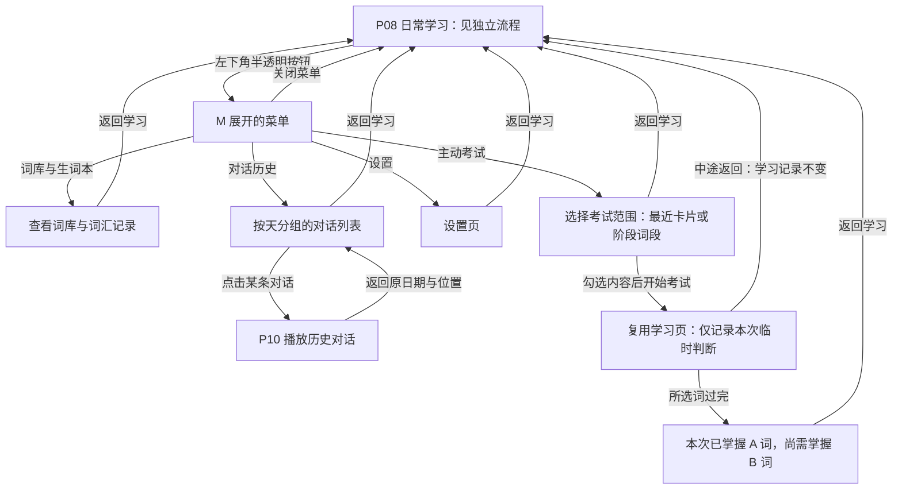
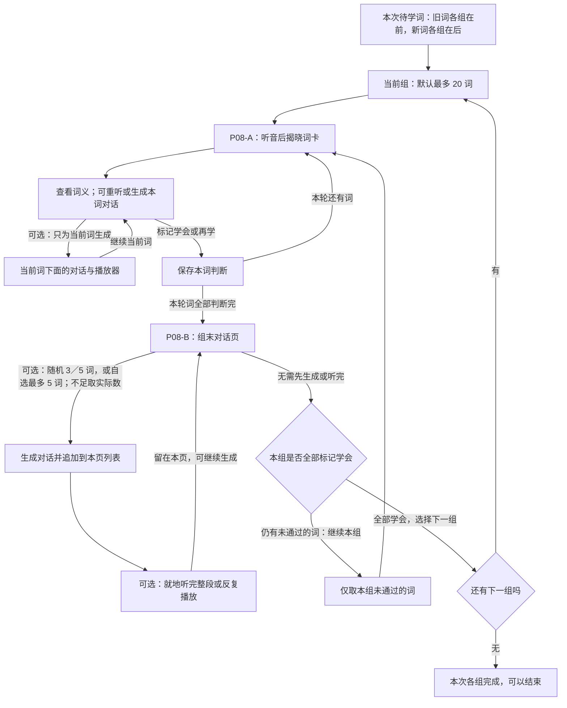

# maidcafe UI 流程讨论记录

状态：独立网页交互原型已完成，等待用户评审；未修改正式 App，未制作或发布新安装包。
本稿记录本轮用户决定，不能把历史文档或助手建议视为已经确认的新需求。

当前进展：主流程和主要功能规则已讨论明确。旧词调度、现有播放器、词库工具及设置已核对源码。独立原型位于 `../../maidcafe-ui-prototype`，包含 30 个可直达页面／情景、125 个示例词和 Kokoro 美式英语音频。用户初步体验后认可流程；补充的 13 条完整旅程、合计 192 项浏览器检查及 14 项状态逻辑测试通过，已修复导航、启动恢复、备份校验和查词续播四个边界问题。测试步骤与结果见原型 `dist/test-report.html`。原型仅写自己的浏览器存储，不访问正式学习记录。正式 App 改造尚未开始。视觉和语言由助手决定，用户要求后续统一更新升级。

## 首轮确认的七项修订

1. 有未完成的测试记录时，P02 增加「继续上次测试」按钮，直接返回 P05。再次打开也必须覆盖这条路线。
2. 全套页面语言应一致，承担与客人交流的作用。当前先定功能；下文文案均为功能占位，后续统一调整。
3. P05 增加「下次继续」，保存测试进度。本稿将其返回位置画为 P02；不自动判为测定完成。
4. 删除 P06 的「调整起点」，本版不做该入口。
5. P07 教学完成后增加 P07B 欢迎完结页，明确告知客人可以正式开始；点击主按钮进入 P08。
6. P09 准备对话是日常学习内部状态，与 P08 词卡、P10 听对话组成独立日常学习图，不与首次欢迎主流程并列。
7. 菜单入口仅在正常学习区域显示；欢迎、选择起点、测试、新手教学和欢迎完结页不显示菜单。菜单项目暂存为草案，尚未逐项讨论。

## 2026年11月9日确认的修订

1. M 菜单使用左下角半透明按钮，点击后展开功能按钮。只在正常学习时显示，先前关于欢迎和引导隐藏菜单的决定不变。
2. 词库与生词本放入 M 菜单，方便客人核查。
3. 对话历史按天分组，选择某一天的对话后进入 P10 播放。
4. 设置放入 M 菜单。
5. 主动考试允许选择范围：勾选最近学习的 10 个以内的卡片，或按词段勾选阶段性单词。已核实当前 server.py 的 BLOCK_SIZE = 100，按难度排序后每 100 词划一段，最后一段可能不足 100；不是每段 50 词。
6. 资源准备属于软件内部核查和处理，不设要求客人配置的资源准备页，不要求客人理解或手动配置词库、模型、引擎、路径；随后用户补充以 P00 插画和进度条呈现加载。
7. 日常词卡采用现有翻卡机制：先听，揭晓词形与词义，再到下一张；可重听。
8. P08 必须有「生成对话」按钮。一次学习过程包含 AI 对话生成，P08 的完整过程下一轮单独讨论，现在不先定自动生成时机、词数门槛、跳转和结束规则。
9. P08 后续确认：普通翻卡揭晓后直接标记学会或再学，日常学习无需依赖主动考试来产生本组的掌握标记。
10. P08 后续确认：必须本组全部学会，才能进入下一组；有未学会的词时继续本组重学流程，不允许提前换组。

## 功能收尾的最新确认

1. 旧词进入本次复习沿用现有记忆调度，已查 `server.py`；不重新制定复习模型。组容量与新旧词分组按新流程适配。
2. 重学时当前词组就是剩余未学会的词，随机和自选均只从当前组取。候选少于 3／5 时使用全部实际候选，例如只剩 1 词则生成 1 词对话。
3. 保留当前英文随播放显示、目标词标记、点词释义的播放器，不增加整段中文翻译，不重做播放交互。
4. 主动考试复用听音、翻卡与判断的学习页面，词数为所选范围实际数量；测完只显示本次已掌握与尚需掌握的数量，不改变学习记录。
5. 词库与生词本的查词、添加词、导入词包、把已学过的词重新加入学习，四项都保留；已有能力复用，缺少的统一入口补齐。
6. 设置沿用源码已有功能范围，不再扩充一批设置；只为新分组流程调整相关语义。
7. 新手教学使用 5 个简单示例词，走最终 P08 的流程，逐步演示不同按钮和学习状态。
8. 出错进入报错页，一个主按钮返回开始并重新初始化。工作解释：重新初始化运行状态并加载已保存数据，保留学习记录、词库、设置和已下载资源；不作为清空数据或恢复出厂设置。
9. 视觉与语言由助手思考并决定，后续统一更新升级；不因此再次要求用户逐项拍板。
10. 用户补充确认：组末播放页不强制听对话。本组全部学会后可以直接进入下一组，生成次数、播放次数和是否听完均不是换组门槛。

## 总图核对后的确认

- 用户接受此前虚线标出的欢迎续接：起点已定但欢迎未结束时回到未完成的 P06／P07／P07B。
- 用户接受菜单返回建议：工具页直接返回原学习位置；从历史进入 P10 后返回原日期与列表位置。
- 内部读取进度和资源核查时，增加 P00 启动加载画面：好看的插画加进度条。不恢复要求客人配置资源的技术向导。
- 总图以这些决定为基础，单独展开 P08 的学习小循环。用户规则已记录，助手细化的交互与视觉方案另列，不能混同为用户逐项指定。

## 已确认的产品边界

- 必须通过测试或自选已掌握档位确定起点，不能跳过，再进入第一次教学与正式学习。
- P02 先选择测试或选档位；选择测试后，P03 才给出抽取、二分、疯狂测试，说明收益与局限。
- 档位表示「客人当前已经熟练掌握的词汇量」，自动学习下一阶段。CET4 之前→CET4，CET4→CET6，CET6→TOEFL，TOEFL→GRE，GRE→实际词库中的后续词汇；无剩余词汇时再扩展词库。
- 教学使用 thank you 等 5 个非常简单的系统示例词，按最终 P08 逐步演示按钮和状态，生成短而简单的对话；不要求客人自己提供例词，自选演示也只在这 5 个词中点选。
- 教学和正式流程统一使用选定的 Kokoro 语音体系，限英音／美音；不能静默换成系统或日语音色。
- 正常学习将本次要背的旧词与新词分开组，先旧词、后新词，每组默认最多 20 词；不足一组的旧词不混入新词补齐。此前「旧词加新词补满同一份」的提案被本轮规则替代。不累计每日欠账，随时可以关闭。
- 对话默认连续听完整段。逐词学习可为当前一个词生成对话；组末允许随机 3／5 词或自选最多 5 词生成。本轮用户要求取代此前「第一版不选目标词」的范围限制。
- 不新增独立「回想」主流程。主动考试由客人从菜单发起，先选范围，复用学习页翻卡和判断；只显示本次掌握／尚需掌握数量，不更新学习记录或复习排期。
- 保留简单翻卡，揭晓后由客人直接标记学会或再学。P08 分为逐词学习与组末对话两个页面，单词对话在词卡下面生成，组末对话在组末页下面累计展示；本组全部学会才能进入下一组，主动考试仍是菜单中的自愿功能。
- 组末对话为自愿生成和播放。进入下一组仅取决于本组全部学会，不以听完对话、覆盖全部目标词或生成次数作门槛。
- 资源核查和准备由软件内部负责，以 P00 插画与进度条呈现加载过程，不增加资源配置向导；与教学、正式学习统一 Kokoro 英音／美音的要求一致。

## 本次重画范围

前三张总图保留已经讨论的首次欢迎、测试续接、再次启动和 M 菜单工具流程。P08 在总图中作为「日常学习」整体，具体在下方独立展开。P09 为日常生成的内部等待状态；P10 保留对话历史的播放跳转。新增的就地播放器可以复用播放功能，不因此要求客人跳到另一个页面。

原虚线的欢迎续接与菜单返回路径已获用户确认，现改为实线。所有按钮文字目前仅标识功能，整套用户沟通语言后续由助手统一调整。P08 的已确认规则与交互细化分别列出。

## 图一 首次欢迎与测试续接

P02 的「继续上次测试」仅在存在未完成测试记录时显示。P05 的「下次继续」保存后返回 P02，恢复测试仍通过该条件按钮进入 P05。

## 图二 再次打开软件

欢迎续接已确认：P06 结果页尚未继续则回 P06；已进入教学但未完成则回 P07；教学完成但尚未点击「正式开始」则回 P07B。交互细化采用按已完成教学步骤续接，不重复已经操作过的教学；已完成欢迎的客人不重复迎宾和教学。

| 页面 | 内容与功能 | 操作 | 结果／去向 | 菜单入口 |
|---|---|---|---|---|
| P00 启动加载 | 插画、进度条，软件内部读取记录与准备资源 | 正常情况下无需操作，加载完成自动进入 | 按进度进入 P01／P02／P06／P07／P07B／P08 | 无 |
| P01 欢迎进店 | 女仆迎宾、一句说明 | 入座 | P02 | 无 |
| P02 选择方式 | 选择如何确定起点；有未完成记录时说明可以继续 | 测试一下；选择已掌握档位；条件按钮：继续上次测试 | P03；P04；P05 | 无 |
| P03 测试方式 | 抽取／二分／疯狂三种单选及优缺点，题量按实际词库显示 | 开始测试；返回 | P05；P02 | 无 |
| P04 已掌握档位 | 五档单选，并说明接下来学习哪个阶段 | 确认起点；返回 | P06；P02 | 无 |
| P05 测试 | 先听音判断，再看拼写判断；必要进度与重听 | 两个判断操作；重听辅助操作；下次继续 | 下一题；测完 P06；保存后 P02 | 无 |
| P06 起点结果 | 说明起点和后续学习阶段，不给调整入口 | 开始体验 | P07 | 无 |
| P07 操作教学 | 用 5 个简单示例词走最终 P08，逐步展示按钮与状态 | 听音、揭晓、学会／再学、重听、本词生成、组末随机／自选、剩余词重学；例词由系统提供 | 完成后 P07B | 无 |
| P07B 欢迎完结 | 明确告知教学结束，可以正式开始 | 正式开始 | P08 | 无 |

测试续接规则：恢复原测试类型、已提交回答和未完成位置；不重新抽成一场新测试。「下次继续」保存成功才返回，保存失败进入统一错误恢复流程。未完成记录不等于已确定起点。交互细化采用保留旧测定档案：换测法另建记录，不把两种测试的回答混合；改选档位后以明确选择的档位为当前起点，不删除已有测试记录。

## 图三 M 菜单及工具页

入口：正常学习时，左下角一个半透明按钮。点击后展开功能；关闭后回到打开前的学习位置。半透明不能影响文字识别或键盘焦点辨认。

| 菜单项目 | 页面内容／操作 | 去向 |
|---|---|---|
| 词库与生词本 | 查看词库与词汇记录；查词、添加词、导入词包、重新加入学习 | 对应工具页；直接返回原学习位置 |
| 对话历史 | 按天分组，每天列出该日对话；点击某条 | P10 播放该条历史对话 |
| 设置 | 沿用已有设置功能；内部资源核查不作为普通用户必经配置 | 设置页；直接返回原学习位置 |
| 主动考试 | 选择范围 → 复用学习页翻卡判断 → 仅显示本次掌握／尚需掌握数量 | 结果页返回原学习位置，不改变学习记录 |

M 菜单沿用上述四项；生成对话的入口已在 P08，不再把重复入口列成待讨论功能。

对话历史返回已确认：从历史进入 P10 时，返回刚才的日期分组和列表位置；从日常学习进入 P10 时，返回日常学习。具体返回按钮文案后续统一。日期分组使用客人设备的本地日期。

图中的 E 为一个考试范围选择页：最近卡片范围内勾选 10 个以内的词卡，阶段范围内按 100 词段勾选。不把两种范围画成两套多级页面。结果仅汇总本次选择的词，不能冒充全局词汇量估计；考试不改变原学习位置或记录。

P00—P07B 全部不显示菜单。教学 P07 即使复用词卡或播放器组件，仍不显示正常学习菜单。

## P08 用户明确的学习小循环

本节替代此前「混合一份词、按翻开顺序攒 1–5 词、跳转播放器」的未确认提案。参考资料见 [背词环节调研](vocabulary-learning-research.md)。本轮仍在讨论设计，没有开始改动 App。

### 1. 分组与顺序

- 本次要背的词明确分为背过的词、新单词两类；先过背过的词，再进入新词。
- 每组默认最多 20 词。旧词多于 20 时拆成多组；新词按相同的组容量组织。20 是每组数量，不是一天必须完成的任务量。
- 两类不混组。例如本次有 45 个旧词与 40 个新词，顺序为旧词 20 → 旧词 20 → 旧词 5 → 新词 20 → 新词 20。
- 「本次要背的旧词」按源码现有调度选取：在学、非当天已处理、记忆权重不高于复习线 70，权重较低的优先；不是全部历史词每天重学。保留这套规则，改变按 20 词分组的呈现及新旧词不混组的组织方式。
- 用户已确认：重学时当前词组就是仍未通过的词，不再是最初的 20 词，也不补入别的词。随机和自选对话都从这个当前词组取。
- 每轮开始固定当轮词表，用于本轮翻卡与组末对话。判断学会后从下一轮待学集合移除，而不是立即从本轮生成候选中消失；这样全部学会后，播放页仍可为刚学完的词生成对话。原始批次关联只用于保存历史与进度，不作为重学时的候选来源。

### 2. P08-A 逐词翻卡页

- 一次显示一个词，保持先听音、再揭晓的简单翻卡；揭晓后直接让客人标记学会或再学，保留重听。
- 额外有一个「生成对话」入口，只以当前一个词作为目标词，不从其他词卡攒词。
- 对话在当前词汇下面生成并播放；该动作不强制跳到组末页或独立播放器。
- 「一个生单词」解释为只指定一个待学目标词；对话仍需使用客人已掌握的常用词组织句子，不能理解为整段只能出现这个单词。该解释属于生成约束的设计建议。
- 当前轮的词逐一完成判断后，进入 P08-B。每组都走这个过程，不等全部旧词、新词的所有组都过完才首次进入对话页。
- 用户已确认：揭晓后直接标记学会或再学。明确点击学会才改变本组掌握状态，揭晓、生成或播放完成都不会自动算为学会。
- 交互建议：揭晓前主按钮是「显示答案」；揭晓后替换为「学会了／再学一次」，任一判断保存成功后直接进入下一词，取消额外的「下一张」点击。最后一个词提交后进入 P08-B；保存失败进入统一错误页，不冒充保存成功或推进到下一词。

### 3. P08-B 组末对话页

- 提供随机 3 词、随机 5 词，以及自己选择目标词的生成方式。
- 随机与自选范围均为当前轮的词组，最多选 5 个；用可点击词片或勾选方式，不要求输入单词。重学剩余词时不再展示原来的 20 词让用户选择。
- 候选不足 3／5 时直接使用实际数量。例如剩 1 词时，随机 3 词和随机 5 词都按 1 个目标词生成，界面显示真实数量；不重复凑数、不取组外词。
- 生成次数不限。同一次生成的词不能重复计数；新一次生成可以再次使用之前选过的词。
- 每次生成的对话都追加在当前页面下面，保留旧条目以反复听，不用新结果覆盖上一段。
- 对话保留现有播放器行为：默认连续播放，英文逐轮显示并标出目标词，可点词查看释义；不增加整段中文翻译。
- 用户已确认不强制听对话。翻卡结束进入本页时，就根据本组掌握状态提供继续操作；全部学会可以直接下一组，还有未学会则继续重学。生成、是否播放、是否听完、词汇覆盖率都不构成换组门槛。
- 可以再次生成或反复听当前页已有对话；播放完成不会自动将词标为学会。继续操作直接在本页呈现，不增加独立学习结算页。

### 4. 重学与下一组

- 本组有未通过的词时，只拿这些词再走 P08-A → P08-B 的标准流程；组末生成和听对话均由客人自愿决定。
- 当前组随着重学缩小；不重新抽取一批新词，不从最初 20 词补齐。
- 用户已确认：本组全部标记学会后才可进入下一组；还有未学会的词时只能继续本组重学，不能提前换组。
- 本轮翻卡即使全部学会，也先进入组末对话页，但可以立即选择下一组，不强制生成或播放。没有下一组时自然结束，不自动创造额外任务。
- 随时关闭软件的原则不变；未完成的组需要保存并在下次续接，重新打开不能丢失记录或绕过本组条件。
- 学会一个词更新日常学习的掌握记录，长期复习继续沿用现有记忆调度，不直接调用生词本的永久毕业操作。主动考试只统计、不写学习记录。同组重复判断用于推进本组，不反复增加长期记忆分值；实现时区分组内进度与现有同日只处理一次的调度规则。

### 页面与按钮建议（布局尚未确认）

| 页面／状态 | 可见内容与操作 | 去向 |
|---|---|---|
| P08-A 揭晓前 | 当前组类型与本轮位置；显示答案；重听；M 菜单 | 留在当前词，揭晓答案 |
| P08-A 揭晓后 | 学会了／再学一次；重听；当前词生成对话；M 菜单。「显示答案」被两个判断按钮替换，不叠加「下一张」 | 保存判断后到下一词；本轮最后一个词提交后到 P08-B |
| P08-A 本词生成 | 原位置显示生成进度、结果与播放；不会改成多词选择器 | 仍在当前词卡 |
| P08-B 生成 | 一组方式选择「随机 3 词／随机 5 词／自己选」与一个「生成对话」主按钮；只有选择自己选时才展开词片和已选数量 | 新对话加入下方列表 |
| P08-B 播放 | 对话列表逐条播放／暂停／重听；默认连续完整播放，不新增逐句选听流程 | 留在本页 |
| P08-B 仍有未学会的词 | 直接显示「再学剩下的 N 词」；不显示「下一组」；不强制生成或听完对话 | P08-A 当前组未学会的词 |
| P08-B 本组全部学会 | 有下一组时直接显示「下一组」；没有则自然结束；不强制生成或听完对话 | 下一组 P08-A |

建议让生成入口在揭晓后与词义一同出现，避免在词形遮住时泄露词汇；该显示时机仍是建议，不是用户已确认的额外规则。菜单仍只在正常学习显示。

### 两项澄清的用户确认结果

1. 用户选择「翻卡揭晓后直接标记学会或再学」。这取代旧实现仅由 `examFinalize` 更新掌握记录的限制，日常学习增加明确自评；主动考试仍自愿，不插入必经流程。
2. 用户选择「必须本组全部学会，才能进入下一组」。流程图已删除提前换组的虚线分支。

上述两项为已确认功能。判断后直接前进、隐藏不可用的下一组入口等具体呈现，是遵循少按钮原则的交互建议；按钮文案仍为占位，不等同于已实现。

### 原型与实现采用的交互细节

- 生成入口在揭晓后显示；等待在当前词下方呈现，不强制切页。允许继续翻卡时，结果必须仍归属发起生成的原词，不落到新词卡；就绪不抢播音频。
- 逐词与组末生成的对话关联到原学习批次并保留，重学不删除已有列表；当前生成选择器始终只显示本轮词组。全局对话历史继续按天呈现。
- 进度保存包括当前组、当前词及揭晓状态、本轮词表、明确判断和生成列表，重新打开恢复安全的已保存位置。生成中断走统一报错与重新初始化流程，不将半成品当成已生成。
- 上述为助手按既定流程细化的设计，不新增顶层入口或必须完成的学习任务。正式实现和原型验证尚未开始。

## 主动考试范围

已确定：不是系统强制发起；客人从 M 菜单进入，自己决定考什么。

| 范围 | 选择单位 | 界面行为 |
|---|---|---|
| 最近学习的卡片 | 单张词卡，10 个以内 | 勾选希望测试的卡片，再点击「开始考试」 |
| 阶段性单词 | 一个难度词段，通常 100 词 | 勾选词段，再点击「开始考试」；最后不足 100 的段显示实际数量 |

范围选择在同一页切换两种范围，只展开当前方式的列表，一个主按钮「开始考试」。交互细化采用每次选一种范围，不混选；「最近学习」按最近实际学习记录去重展示，可跨启动，但一次最多勾选 10 张卡片。词段模式按实际所选数量考试，不再强制拆成 20 词。

考试复用 P08 的听音 → 揭晓 → 两个判断操作，所选词只过一遍，判断后进入下一词。考试模式下的回答只供本次临时统计，不调用写入学习掌握或复习排期的接口，也不从日常学习的当前组中删词。

用户已明确：测完只显示「本次已掌握 A 个词，尚需掌握 B 个词」，一个返回学习操作即可，不加成绩等级、排行或强制重考，不要求未掌握清零。这里的 A／B 只针对本次选定范围，不是客人的全局词汇量。考试不增加必经的对话生成和播放环节。

中途退出返回原学习位置，不把未回答的词算成未掌握，不改变日常学习记录。当前考试的临时结果与日常学习持久记录隔离，重开考试不继承一个未说明的评分结果。

这里的 100 词段来自现有全局难度排序，不等于一个 CET4／CET6 大档；一个考纲阶段包含多个词段。阶段考试不能被表述为已完成入门测定，两者用途不同。

## P00 启动加载与内部资源准备

用户已要求以好看的画面和进度条呈现内部读取进度及资源准备。P00 统一展示插画、进度条和简短状态；正常完成后自动进入对应页面，不增加一个需要客人点击的「继续」步骤。

软件内部完成资源核查、可用资源复用、必要准备和就绪检测；不把模型名称、运行引擎、目录配置等变成新手必学内容。可量化的下载或加载显示真实进度，不可量化阶段用等待状态，不用纯计时动画伪造完成百分比，也不为展示插画故意延长等待。

资源不足或不可用时，内部重试与恢复不能伪装成已经就绪，也不能静默换成不符合要求的语音。失败时走下面的统一错误页；不恢复技术配置向导。

## P07 五词教学脚本范围

用户已确定使用 5 个简单示例词，复用最终 P08 的组件和流程，逐步演示按钮与不同状态。示例可采用 hello、please、thank you、coffee、welcome；这是助手选择的教学内容，不影响先前确定的学习起点。

| 教学步骤 | 演示内容 |
|---|---|
| 第一次翻卡 | 听音后只突出「显示答案」，点击后再解释词形和词义 |
| 判断与重听 | 按次序介绍学会、再学和重听；判断保存后进入下一词，所有演示只写教学状态 |
| 单词语境 | 演示在当前词下生成极短对话，播放器沿用正式学习的英文显示与点词释义 |
| 组末语境 | 走完 5 词后展示随机 3、随机 5、自选至多 5 的操作；自选用这 5 个现成词演示，不让用户提供词 |
| 剩余词重学 | 用教学示例保留的未学会词演示缩小词组、按实际词数生成，以及全部学会后出现下一组；不把教学判断写入真实词汇掌握记录 |
| 欢迎结束 | 展示 P07B，明确正式学习可以开始；点击进入真实 P08 |

教学不需要为每个按钮都另开页面；同一个页面分步说明，一次只突出当前需要操作的按钮。对话实时生成时使用统一 Kokoro 英音／美音与极简单句子，不使用不同的系统语音做替身。正式学习可以不听对话直接下一组，这一点也要在教学中说明。教学演示不伪造真实考试或掌握证据。

## E 统一错误与重新开始

用户要求：出错显示报错页，一个按钮回到开始界面，初始化软件重新来。

采用的安全工作解释：重新初始化运行状态，保留持久数据，不等同于清除学习记录、删除词库或恢复出厂设置。错误页显示简短说明；一个主按钮「返回开始」停止本应用出错的当前操作，重新进入 P00 读取保存的进度、检查资源并按当前阶段进入欢迎、测试、教学或学习。未保存的判断不冒充保存成功，已保存的判断不回滚；错误任务不能在重开后继续把结果写到错误的词组。

没有历史对话、没有待复习词或词库已学完是正常状态，不按错误处理。没有旧词直接进入新词；暂时没有待学词保留正常学习中的 M 菜单，可查看历史、查词或导入词包，不新增强制任务。

## 源码核查与保留范围

本节为静态源码核对，不表示已运行验证，也不表示新流程已经实现。

| 功能 | 已有实现与发现 | 新流程处理 |
|---|---|---|
| 旧词复习 | `server.py` 的 `srs_weight`、`srs_map`、`build_session`：在学词权重随时间变化，低于等于 70、非当天已处理的词进入复习，权重低的优先 | 保留候选判断与排序；旧实现仅取至一份上限并用新词补齐，新版改为新旧分开、多组依次学习 |
| 记忆记录 | `srs_pass`／`srs_fail` 已有进步、遗忘及同日去重规则，现从考试路径调用 | 日常翻卡负责学习反馈；组内循环与长期同日去重分开，主动考试不写入；日常「学会」不能误用 `/api/word/learned` 的直接毕业语义 |
| 播放器 | `static/home.js` 的 `lsRenderTurns`／`lsPlayTurn` 显示随播放逐轮揭示的英文、目标词标记及点词卡；`static/listen.js` 提供历史播放器和释义；无整段中文翻译 | 保留播放体验，复用到新布局，不增加中文整段翻译；既有语音引擎与英美音一致性要求仍须落实 |
| 查词 | `/api/lookup` 可查释义、音标、词根与状态；已有对话点词查询和毕业词搜索 | 底层已有，但还没有统一面向全部词库的独立查词输入；在词库与生词本中接入已有查询功能 |
| 添加词 | 生词本的手动加词、点词卡加词；`/api/wordbook_add` | 保留并整理入口，已存在的词不重复添加 |
| 导入词包 | 设置已有 `.apkg` 导入，`/api/decks/import` 校验并读取；生词本还支持粘贴或 `.txt` 词表导入 | 复用两种导入能力，词库页接入同一流程；保留现有兼容格式和大小校验，不将「支持 Anki」误写为所有格式皆可 |
| 重新学习 | 已毕业词可点开「再学一遍」，调用 `/api/word/readd`；手动加已知词时也有重学提示 | 保留，与新分组调度接好，不强行塞入正在学习的当前组 |
| 主动考试 | `static/home.js:examFinalize` 当前调用 `/api/word_pass`、`/api/word_fail` 并影响会话词池 | 必须改成隔离的临时统计。保留卡片表现不能意味着照搬已有写入行为 |

### 设置保留清单

已核对 `static/home.html` 的设置弹窗及故事助手弹窗、`static/setup.js`：

- 学习数量设置：已有 1–100 的范围、默认 20。新版文案与含义改为「每组词数」，不再写「复习加新词补满」。设计采用从下一组起生效，当前组与本轮候选保持不变。
- 配图模式：每次换景、固定配图、减少配图；保留。
- 故事助手与配音：已有标准／轻量方案、一键准备、暂停下载、已有本地模型选择与重新检测；保留功能作为设置内的可选维护入口，不恢复为新手必经技术向导。
- Anki 词包导入、学习记录导出与恢复；保留。现有备份不含词库、模型和录音，恢复仅允许空学习记录的安装，这些能力边界不扩大宣传。
- 重看迎宾、下载入门词包、校准工具的现有入口；在设置中保留，不加回学习主界面，也不恢复已删除的 P06 调整起点按钮。

页面中已存在的旧说明，例如「主动考试改变记忆程度」「每份新旧词补满」，需要随功能改造更新，不能以保留设置为由保留与新流程矛盾的含义。

## 接下来：原型验证，再改造 App

- 功能主线已明确，不再将旧词来源、重学范围、播放器翻译、考试是否改记录等已决事项重复列为待讨论。
- 先制作可点击网页原型，核对逐步教学、每页可见按钮、原地生成、当前组缩小、组末自由播放、考试只统计、工具返回与错误重启。
- 验证五类关键情形：旧词超过一组；只剩 1 词；全部已学会但未生成或播放任何对话；考试结果不改变学习状态；错误恢复后仍保留进度。
- 视觉和页面语言由助手决定，结合既有角色定妆与少按钮原则统一更新；本稿中的功能按钮名仍是工作文案。
- 本轮只完成源码核查与设计记录，尚未修改正式 App、制作新原型或打包发布。
